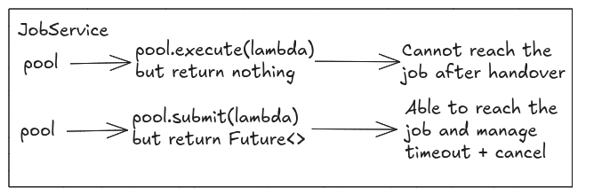

# Cancel Job
We decided to work with Executor Service, and at the first version we use the method `execute(job)` to submit the job to the executor service. This method will not return any value, and we will not be able to know when the job is completed or if it is failed.

### Decision



#### Submit() instead of execute() 
To be able to cancel the job and get the result of the job, we need to use the method `submit(job)` instead of `execute(job)`. This method will return a `Future` object that we can use to check the status of the job, cancel the job, and get the result of the job.


#### Storing Future with concurrent hashmap

Beside that, we already have `IStorageService`, we now will create `FutureActiveStorageService` that will store the `Future` object of the job. This way, we can use the `Future` object to cancel the job and get the result of the job.

Sample code: For further reference, please check the `JobService.java` class in the `mcp_document_processing` project.

```java
public class JobService {
    private IStorageService<Job> jobStorageService;
    private IStorageService<Future<?>> futureStorageService;
    private ExecutorService pool;

    // ...
    public String submitJob(String filePath) throws IllegalStateException, RuntimeException {
        Job job = new Job(...);

        jobStorageService.store(job.id().toString(), job);
        synchronized (futureLifecycleLock) {
            try {
                Future<?> queuedJob = pool.submit(() -> {
                    try {
                        processJob(job);
                    } finally {
                        synchronized (futureLifecycleLock) {
                            futureStorageService.delete(job.id().toString());
                        }
                    }
                });
                futureStorageService.store(job.id().toString(), queuedJob);

            } catch (RejectedExecutionException e) {
                jobStorageService.delete(job.id().toString());
                futureStorageService.delete(job.id().toString());

                throw new IllegalStateException("Server busy, retry later");
            }
        }

        return job.id().toString();
    }
    // ...
}
```

#### Synchronized keyword
The reason for using the `synchronized` keyword is to ensure that the `Future` object is stored and deleted in a thread-safe manner. 

The first version of `JobService::submitJob` look like this:
```java
public String submitJob(String filePath) throws IllegalStateException {
    Job job = new Job(
            java.util.UUID.randomUUID(),
            Map.of("filePath", filePath.trim()),
            null,
            JobStatus.PENDING,
            "Job for file: " + filePath,
            "Processing file: " + filePath);

    jobStorageService.store(job.id().toString(), job);
    try {
        Future<?> queuedJob = pool.submit(() -> processJob(job));
        futureStorageService.store(job.id().toString(), queuedJob);
    } catch (RejectedExecutionException e) {
        // Handle the case where the task cannot be executed
        jobStorageService.delete(job.id().toString());
        futureStorageService.delete(job.id().toString());
        throw new IllegalStateException("Server busy, retry later");
    }

    return job.id().toString();
}
```

And the futures removing works is belong to the `JobService::processJob`
```java
private void processJob(Job job) {
    // Set job status to inprogress
    jobStorageService.checkAndUpdate(job.id().toString(), job.WithStatus(JobStatus.IN_PROGRESS));

    try {
        if (Thread.currentThread().isInterrupted()) {
            System.err.println("Throw InterruptedException for job " + job.id());
            throw new InterruptedException("Job is canceled");
        }
        ParserTool parserTool = ToolRegistry.getInstance()
                .getToolByFileExtension(job.request().get("filePath").toString());

        String result = parserTool.execute(job.request().get("filePath").toString());
        jobStorageService.checkAndUpdate(...);

    } catch (RuntimeException e) {
        System.err.println("Error processing job " + job.id() + ": " + e.getMessage());
        jobStorageService.checkAndUpdate(...);
    } catch (InterruptedException e) {
        Thread.currentThread().interrupt();
        System.err.println("Cancaled Job " + job.id() + ": " + e.getMessage());
        jobStorageService.checkAndUpdate(
                job.id().toString(),
                job.WithResult(Map.of(CANCELED_KEY, "Job is canceled!")).WithStatus(JobStatus.CANCELED));
    } finally {
        futureStorageService.delete(job.id().toString()); // <-- This line is important to remove the future from the storage when the job is completed or canceled
    }
}
```

The problem is when the job is completed too fast, the `processJob(job)` method will be executed and completed before the `futureStorageService.store(job.id().toString(), queuedJob);` line is executed. This will cause the `Future` object to be deleted from the `futureStorageService` before it is stored, and we will not be able to cancel the job or get the result of the job.

So we first we move it out of the `JobService::processJob` method and put it in the `JobService::submitJob` method so we can have much more control over the process. But it not completely solve the problem:
```java
public String submitJob(String filePath) throws IllegalStateException, RuntimeException {
    Job job = new Job(...);

    jobStorageService.store(job.id().toString(), job);
    try {
        Future<?> queuedJob = pool.submit(() -> {
            try {
                processJob(job);
            } finally {
                futureStorageService.delete(job.id().toString());
            }
        });
        futureStorageService.store(job.id().toString(), queuedJob);

    } catch (RejectedExecutionException e) {
        jobStorageService.delete(job.id().toString());
        futureStorageService.delete(job.id().toString());

        throw new IllegalStateException("Server busy, retry later");
    }

    return job.id().toString();
}
```
This still cause the same problem about delete the future before it is stored, so we need to use the `synchronized` keyword to ensure that the `Future` object is stored and deleted in a thread-safe manner.

```java
private Object futureLifecycleLock = new Object();

synchronized (futureLifecycleLock) { // <-- Acquire the lock to ensure that the future is stored before it is deleted
    try {
        Future<?> queuedJob = pool.submit(() -> {
            try {
                processJob(job);
            } finally {
                synchronized (futureLifecycleLock) {
                    futureStorageService.delete(job.id().toString()); // <-- Even the job is completed, it cannot delete the future because the lock is acquired by the outer synchronized block
                }
            }
        });
        futureStorageService.store(job.id().toString(), queuedJob); // <-- Perform store operation, end of block, release the lock 

    } catch (RejectedExecutionException e) {
        // ...
    }
}
```

A worker processes the Job and acquire the lock, even the job is quickly finished, it cannot delete the job because the lock is acquired by the outer synchronized block. It then comes to the outer synchronized block, and it can store the future. After that, the worker can acquire the lock and delete the future object. This way, we can ensure that the future object is stored before it is deleted.

#### Canceling the job
- To cancel the job, we can use the `Future` object that is stored in the `FutureActiveStorageService`. We can call the `cancel(true)` method on the `Future` object to cancel the job.
- The one write the cancel flag to `true` is the `JobService::cancelJob(String jobId)` method, and the one read the cancel flag is the `JobService::processJob(Job job)` method. 
- The `processJob(Job job)` method will check the cancel flag when the job is picked up, and if the cancel flag is set to `true`, it will throw an `InterruptedException` to stop the job.
- With the pending job, it wont be picked be cause it already set the cancel flag to `true`, so it will be removed from the queue and never be picked up by the worker.
- Beside setting the cancel flag and delete the `future`, the `cancelJob(String jobId)` method will also update the Job's result status to `CANCELED`
```java
public CallToolResult cancelJob(String jobId) {
    // ...
    Future<?> future = futureStorageService.retrieve(jobId);
    if (future == null) {
        throw new IllegalArgumentException("Future not found for job: " + jobId);
    }

    boolean cancelled = future.cancel(true);
    futureStorageService.delete(jobId);

    boolean updated = jobStorageService.checkAndUpdate(
            job.id().toString(),
            job.WithResult(
                    Map.of(JobStatus.CANCELLED.getLabel().toLowerCase(), 
                    "Job is cancelled!"))
                .WithStatus(JobStatus.CANCELLED));

    boolean success = cancelled && updated;
    return CallToolResult.builder()
            .isError(!success)
            .addTextContent(success ? "Job cancelled successfully" : "Failed to cancel job")
            .build();
}
```