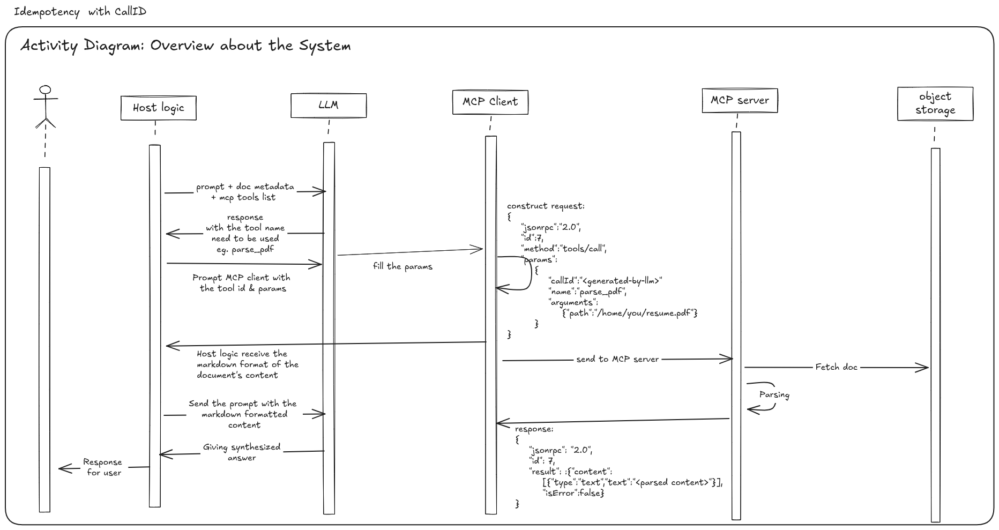
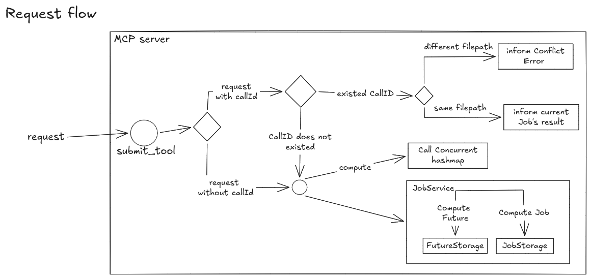

# Idempotency Key




### Why we need idempotency key?
Idempotency key is used to make sure the request is only processed once no matter how many times the client sends it. This is important for avoiding duplicate processing of the same request, which can lead to data inconsistency or unexpected behavior in the system.

### How can it be implemented?
We can use ConcurrentHashMap. Currently, in codebase, that datas structure is used for two purposes:
    1. Storing Jobs - Result
    2. Watching Future returned by `submit` method for cancelling if needed
  
It might be used for storing `callId` also. `callId` is representing for idempotancy key, which make sure the request is only processed once no matter how many the client sends it.

> fyi: `callId` is just parameter of a request, it will be generated/filled by the LLM.

Lets first decide what will be stored along with the `callId`.
 - `jobId` --> So the behavior will be like: Client resend the request with same `callId` again while server is processing it --> check the storage --> get `jobId` --> query the JobStorage to get the result --> return.
 - The `filepath` - or the request body if we work with HTTP request instead of json-rpc: Why? Client can send the same `callId` request but different `filepath`, we have to store the path so it the server wont process the same call id for two different file. This can lead to data lost (overwrite the `jobId` for the same `callId` ). 

#### The relations
- `jobId` is used as key for:
    1. JobStorage: mapping `jobId` with Job for O(1) retrieving
    2. FutureStorage: `jobId` with future<?>
- `callId` will be used as a key mapping with Pair<`jobId`, `filePath`>. 
- from `callId` --> get `jobId` --> get `Job` from `JobStorage` --> get `result`
### The Solutions

#### The core Idea
 

When the request comes, it would be interpret by the `JobTools::getSubmitTool` method. This method will check if the `callId` is already stored in the `callStorage`. If it is, it will return the existing `jobId`. If not, it will submit a new job and store the `callId` along with the new `jobId` and `filePath`.

Since the `jobId` only be generated when the `JobService::submitJob` returned, we have to call the `submitJob` along with the callStorage to store the `callId`. But we not always call the submit, here is some certain situation we have to check before calling the submit:
- If the `callId` is already stored:
  - Check if the `filePath` is the same as the one in the request:
    - No? Throw an exception
    - Yes? we will return the existing `jobId`.
- If the `callId` is not stored: Submit the job and store the `callId` along with the new `jobId` and `filePath`.

#### First solution:
```
// Within JobTools::getSubmitTool
  `IStorageServer<CallEntry>` callStorage = Config.getCallEntryStorageService(); <-- a concrete class of `IStorageServer<CallEntry>` will be created and injected into JobTools

  entry = callStorage.retrieve(callId_from_request)
  
  if entry is null {
      normally submit the job and add to callStorage
  }

  if entry is not null {
      check if it hold the same path as the request
          --> if not throw exception    
  }

  return current jobId of existed Entry
```
##### Why this fail
1. We trieve and then compute --> retrieve result can be stale --> which means that multiple threads can access it simultaneously and cause race conditions.
    ```
    Thread A: Retrive null
    Thread B: Retrive null

    ThreadA: Start to add Call and Submit Job for CallID-A and path-X
    ThreadB: Start to add Call and Submit Job for CallID-A and path-X
    ```
   - This can give only one stored CallID which mean the threadB wont be stored to the callsStorage BUT it still submit the job so we have:
       - 1 callID pair
       - 2 jobID pairs
    &rarr; Failed

2. We cannot rollback the `jobId` if the `callId` is already stored but the `filePath` is different. 
- My idea is somehow we have to be able to rollback the JobID. To make this happend, the `CallsStorageService` should be able to rollback the `jobId` which mean it need to know about JobService. 
- With the first verison we cannot combine two operations (store `callId` and submit job) into one operation. Therefore:
  - JobSubmit need to be done in JobTools, not in IStorageService
  - Store `callId` need to be done in JobTools, not in IStorageService
  &rarr; Hard to manipulate when to submit the job based on certain conditions.

#### Second solution:
- By the suggestion of Claude, instead of create a concrete class for `CallsStorageService`, I should use directly the `ConcurrentHashMap` in the `JobTools`.
- Why this make sense? Along with the `callId` storing works, we have to submit the job. This is why the first solution meet obstruction. 

Current Solution:
```java
private `ConcurrentHashMap<String, CallEntry>` callsStorage = new ConcurrentHashMap<>();

if (callId != null && !callId.isEmpty()) {
    CallEntry e = callsStorage.compute(callId, (k, value) -> {
        if (value == null) {
            String jobId = jobService.submitJob(filePath);
            return new CallEntry(filePath, jobId);
        }

        if (!value.getFilePath().equals(filePath)) {
            throw new RuntimeException(
                    "Call ID already exists with a different file path: "
                            + value.getFilePath());
        }

        return value;
    });

    return CallToolResult.builder()
            .addTextContent("File path: " + filePath)
            .addTextContent("Call ID: " + callId)
            .addTextContent("Job ID: " + e.getjobId())
            .build();
}
```
- `callsStorage`: not a concrete class of `IStorageServer<CallEntry>` but a `ConcurrentHashMap<String, CallEntry>` in JobTools. This is because we have to submit the job along with the `callId` storing works. Therefore, we won't separate these two operations into two different classes.
- Why `compute` but not `putIfAbsent` or `computeIfAbsent`? Regard the situations I listed at the [The core Idea](#the-core-idea), we wont always `submitJob`. Using compute give us much more control over the logic so we can decide when to submit the job and when to throw an exception.


---

- [ ] track what I have done
- [ ] Solve the Concurrency Problem in JobTools::getSubmitTool