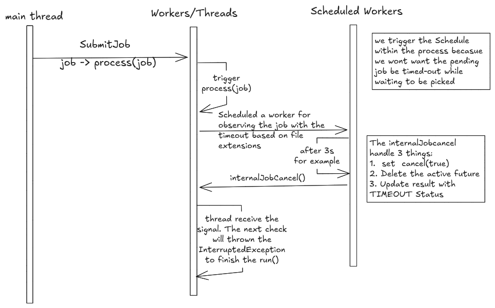

# Timeout job
Timeout inherits a lot of works of Cancel job. The difference is jobs will be cancel after certain amount of time. The timeout value is based on the file extension. For example, if the file extension is `.pdf`, the timeout value is 10 seconds. If the file extension is `.XLSX`, the timeout value is 20 seconds. 



## Options
#### `Future.get(timeout, unit)`
We can use the `Future.get(timeout, unit)` method to wait for the job to complete for a certain time. If the job is not completed within the time, we can cancel the job and throw a `TimeoutException`. 

#### Scheduler
This idea is to spin up a scheduled worker, its jobs is based on job that submit for the parsing workers. The idea is, the worker will sleep until the job is completed or the timeout is reached, the unit of times is based on the file extension. 

If the job is completed, the worker will do nothing. If the timeout is reached, the scheduler will set the interrupt flag to true and update the Job Result to `TIMEOUT` (these two of works is in the internal method `cancelTimeoutJobInternal(String jobId)`).

### Trade-offs
#### `Future.get(timeout, unit)`
- Pros:
  - Simple to implement
  - No need to manage a separate worker for timeout
- Cons:
  - `future.get(timeout, unit)` blocks the calling thread until the job completes or the timeout expires. In this design, blocking request or worker threads for every timeout could exhaust the bounded thread pool
 


| Who calls get(timeout)| What goes wrong |
|---|---|
| The handler thread, inside submitJob | submit_job would not return until the job finished. That throws away the async design: the job ID is meant to come back immediately.|
| The worker running the job | It would be waiting on its own result, which can't finish while it waits. It has to wait for itself.|
| A new thread per job, created only to wait     | This works, but each job holds a sleeping thread. 100 jobs means 100 threads doing nothing.|

#### Scheduler
- Pros:
  - No need to block the calling thread
  - No need to create a new thread for each job
- Cons:
  - More complex to implement

## Decision -- Scheduler
```java
    private void processJob(Job job) {
        // Set job status to inprogress
        try {
            if (Thread.currentThread().isInterrupted()) {
                System.err.println("Throw InterruptedException for job " + job.id());
                throw new InterruptedException("Job is cancelled");
            }

            scheduler.schedule(
                    () -> cancelTimeoutJobInternal(job.id().toString()), // <-- a lambda expression that calls the cancelTimeoutJobInternal method with the job ID as a parameter
                    ToolRegistry.getInstance()
                        .getToolTimeout(job.request().get("filePath").toString()), // <-- get the timeout value for the job based on the file extension
                    TimeUnit.MILLISECONDS); 

           // ...
        } catch (RuntimeException e) {
            // ...
        } catch (InterruptedException e) {
            Thread.currentThread().interrupt();
            System.err.println("Cancelled Job " + job.id() + ": " + e.getMessage());
        }
    }
```

### Limitations
The timeout value is based on the file extension is not an optimal solution. We can improve this by using a more sophisticated algorithm to determine the timeout value based on the file size, file type, and other factors.