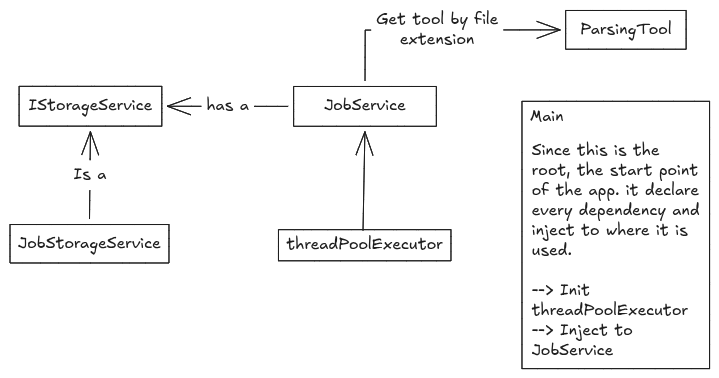

# Worker Pool Reasoning
Conversion is a heavy task and it might consume alot of CPU and memory. If we have a lot of requests, we might run out of resources and the server will crash. To avoid this, we can use a worker pool to limit the number of concurrent jobs that can be processed.

### Decision
At this first version, I might want it simple, like a POC, that will use the worker pool to limit the number of concurrent jobs that can be processed. The worker pool will be implemented using Java's built-in ExecutorService. The ExecutorService will manage a pool of threads that will execute the jobs. The number of threads in the pool can be configured based on the server's resources.

Used work with a product that fork a brand new app docker container and use it as a worker. With this app, we can basically create a ThreadPoolExecutor.
- A brand new app &rarr; new process
- A thread &rarr; a thread within process &rarr; the current app

The one can access to the pool is the one know every detail of the job 
&rarr; Job service

#### Bounded thread pool
The ExecutorService was initialized with a waiting queue upto 2 jobs. If the queue is full, the `submitJob` method will throw a `RejectedExecutionException` and the client will be asked to retry later. This is to avoid the server from being overwhelmed with too many concurrent jobs.

### Sample diagram

Since the parsing tools is now used by JobService. We are not exposing those to the client anymore. Now we offer client:
  1. Submit Job
  2. Get job's status
  3. Get job's result

We do this because of the app - server will be the one managing "Who/when execute the jobs". The flow we desired is request comes -- Job create -- assign for a thread/worker. 

If we keep the exposing the parsing tool for client, when client call the tool it will need to manage thread pool and add the job --> Not really a parsing anymore, it now named as parsingTool but handling thread pool.