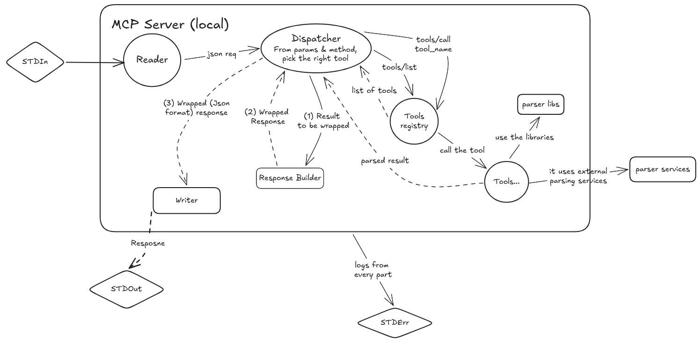

# Json-RPC handwritten
Practice for implementing a Json-RPC server and client in Java without using any frameworks. This project is part of the MCP (Model Context Protocol) document processing system.

### Status
The project is mostly complete, with the core functionalities implemented. Able to handle connection establishment, request parsing, response generation, and error handling. Further enhancements and optimizations are planned.

### Quick start
Prerequisites:
- Java 21
- Maven 3.6 or higher

### Limitations
Since this is for me to learn about the structure of a Json-RPC server and client, the implementation is basic and may not cover all edge cases or advanced features. Future versions may include more robust error handling, support for additional data types, and improved performance.